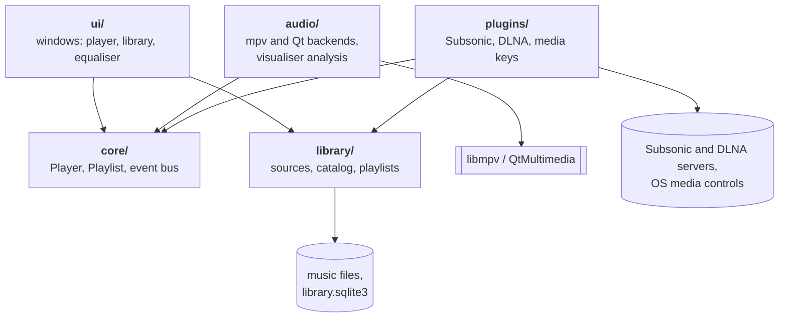

<p align="center">
  
</p>

<p align="center">
  <a href="https://github.com/kamranzafar/pyamp/actions/workflows/ci.yml"></a>
  <a href="https://github.com/kamranzafar/pyamp/actions/workflows/package-macos.yml"></a>
  <a href="LICENSE"></a>
  <br>
  
  
  
  
  <br>
  <a href="https://github.com/astral-sh/uv"></a>
  <a href="https://github.com/astral-sh/ruff"></a>
  <a href="https://mypy-lang.org/"></a>
  <a href="https://pre-commit.com/"></a>
</p>

## Installing on macOS

Download `PyAmp-<version>-macos-<arch>.dmg` from the
[latest release](../../releases/latest) (`arm64` for Apple Silicon, `x86_64` for
Intel Macs), open it and drag **PyAmp** to Applications. libmpv is bundled, so the
`mpv` backend, the equaliser and gapless playback work without installing anything
else.

The app isn't notarised yet, so the first time macOS will refuse to open it. Open
**System Settings → Privacy & Security**, scroll down to the message about PyAmp and
click **Open Anyway** (on macOS 14 and earlier, right-clicking PyAmp → **Open** also
works). If something doesn't work, run
`/Applications/PyAmp.app/Contents/MacOS/PyAmp --self-test` and include the output
in a bug report.

Builds of every change (not just releases) are attached to the runs of the
[*Package (macOS)*](../../actions/workflows/package-macos.yml) and
[*Package (Windows)*](../../actions/workflows/package-windows.yml) workflows (sign in
to GitHub to download them).

## Installing on Windows

Download one of these from the [latest release](../../releases/latest):

- **`PyAmp-<version>-windows-x86_64-setup.exe`** (recommended): the installer. It
  installs for your user only (no administrator rights), adds PyAmp to the Start menu,
  upgrades an earlier version in place and can be removed from **Settings → Apps**.
- `PyAmp-<version>-windows-x86_64-portable.zip`: the portable version, e.g. for a USB
  stick. **Extract it first** (right-click → **Extract All…**), then run `PyAmp.exe`
  from the extracted folder; it doesn't run from inside the zip. To upgrade, replace
  the whole folder.

libmpv is bundled, so the `mpv` backend, the equaliser and gapless playback work
without installing anything else. 64-bit Windows 10 or 11 (on ARM it runs under
emulation).

The builds aren't code-signed yet, so Windows SmartScreen will warn the first time
("Windows protected your PC"): click **More info** → **Run anyway**. If something
doesn't work, run `pyamp-console.exe --self-test` from PyAmp's folder (the
installer puts it in `%LOCALAPPDATA%\Programs\PyAmp`) and include the output in a
bug report.

## Running

```bash
uv sync
uv run pyamp                      # restores your last playlist
uv run pyamp ~/Music/album/       # files, folders or .m3u/.pls playlists
uv run pyamp --log-level INFO     # see plugin activity, e.g. "Now playing: ..."
```

| Key            | Action                     |
|----------------|----------------------------|
| `Z X C V B`    | Prev / Play / Pause / Stop / Next (classic Winamp) |
| `←` `→`        | Seek -/+ 5 s               |
| `S` / `R`      | Shuffle / cycle repeat (off → all → one) |
| `Enter`, double-click | Play selected track |
| `Delete`       | Remove selected tracks     |
| `J`            | Jump to track              |
| `Ctrl+N` / `F2` | New / rename playlist     |
| Click the time | Toggle elapsed / remaining |

Drag and drop files or folders onto the window to add them.

Under the track title, the display shows the bitrate and sample rate of what's playing
(e.g. `320 kbps · 44.1 kHz`), as the audio engine reports them; for VBR files and
streams on the `mpv` backend the bitrate follows the music as it plays.

### Playlists

Keep as many playlists as you like and switch between them with the selector above
the list. **Changes are saved automatically**: there's no Save button. New, Rename
and Delete are in the **Playlist** menu. The playlist that was open last comes back
on the next start. Playlists are stored as `.m3u8` files in PyAmp's data folder
(`~/Library/Application Support/pyamp/playlists` on macOS); **File → Import/Export
Playlist** reads and writes playlist files anywhere else.

Editing the open playlist:

| | |
|---|---|
| Drag tracks | Reorder (drop files from Finder/Explorer to add them) |
| **Playlist → Sort by** | Title, Artist, Album, File name, Duration, or Reverse order |
| **Playlist → Remove Duplicates** | Drop repeated files (keeps the one playing) |
| `J` | **Jump to Track**: type part of a title or file name, Enter plays it |
| `Delete` | Remove the selected tracks |
| Right-click | All of the above |

### Library

**Library → Show Library** (`Alt+L`) opens a window with all your music, browsable by
artist, album, genre and folder, with a search box. Add music with **Add Folder…** or
**Add Files…** (in the window or the Library menu). Tags are read once, in the
background, at low priority, so the music keeps playing while a large folder is
scanned. PyAmp checks for new, changed and deleted files a few seconds after it
starts, and when you click **Rescan**. Only files that changed are read again.

- Double-click a track (or press Enter) to play the tracks shown, starting there. They
  play in a playlist called **Library**, so your other playlists stay as they are.
- **Add to Playlist ▸** (right-click) adds the selected tracks to any saved playlist,
  or to a **New Playlist…**. Right-click an artist, album or genre in the sidebar to
  add all of it (a new playlist is named after it). Tracks already in the playlist are
  skipped. Or drag tracks onto a playlist under **Playlists** in the sidebar (onto
  **Playlists** itself for a new one), or into the open playlist in the player (songs
  from a server keep their tags).
- **Playlists**, in the sidebar, lists your saved playlists. Pick one to see its tracks
  (with the library's tags; no music files are read); right-click it to open it in the
  player, rename it or delete it. Right-click **Playlists** itself for **New
  Playlist…** (an empty one, ready to drop tracks onto) or **Import Playlist…** (a
  playlist file, opened in the player). Changes made in the player show here once
  saved.
- **Smart Playlists**, in the sidebar, are rules that pick tracks from the library
  for you (see [Smart playlists](#smart-playlists)).
- Under the sidebar is the artwork of the track you've picked (or of the first one
  listed): the picture in the file's tags, else a `cover`, `folder`, `front` or `album`
  image (`.jpg`, `.png` or `.webp`) in its folder; a server's cover for its songs. Drag
  the line above it to make it bigger.
- Right-click a folder under **Folders** to remove it from the library. The files stay
  where they are: PyAmp only reads your music files, and never retags, renames or
  moves them.

If a folder isn't there when PyAmp scans (e.g. on a drive that isn't connected), its
tracks are kept until it's back. The library is a single `library.sqlite3` file in
PyAmp's data folder.

The library window also shows music from elsewhere, each in its own part of the
sidebar under **This Computer**: each [Subsonic server](#subsonic-servers) you add,
each [DLNA/UPnP server](#dlnaupnp-servers) on your network, and sources added by
plugins. They're browsed, searched and played the same way, and a
slow or unreachable server never holds up the window. Picking a server's name
searches the whole server.

### Smart playlists

A smart playlist is a set of rules, not a list of tracks: it shows whatever in the
library matches them right now, so it keeps up with new music after each scan.
Right-click **Smart Playlists** in the library sidebar and choose **New Smart
Playlist…**, then add rules such as:

- **Title, Artist, Album, Album artist or Genre** contains, doesn't contain, is, is not
  or starts with some text (ignoring case). "Genre is" with nothing typed finds tracks
  with no genre.
- **Year or Length** (in seconds) is, is not, is at least, is at most or is between.
  Tracks whose year or length isn't known are left out of ranges.
- **File type** is or is not, e.g. `flac`.
- **Folder** is in or is not in one of the library's folders.
- **Date added** is in, or is not in, the last so many days. A file's date added is its
  modified date when PyAmp first found it, and stays the same if the file changes.

Choose whether a track must match **all** the rules or **any** of them, how to sort
them (album order, random, title, artist, year, most recently added, longest or
shortest first), and, if you like, a limit, e.g. 50 tracks. **Random** with a limit
picks a new set each time you open the playlist. As you edit, the dialog shows how
many tracks match. With no rules at all, the whole library matches.

Right-click a smart playlist to edit, duplicate or delete it; play it and add its tracks
to playlists like any other part of the library. Smart playlists only look in the
library on this computer (not servers), and change nothing in your music files: they
are kept in `smart_playlists.json` in PyAmp's data folder.

### Audio backends

| Backend | Default | Gapless | Equaliser | Visualiser | Needs |
|---|---|---|---|---|---|
| `mpv` (libmpv) | yes | **yes** | **yes** | yes (analysed) | `brew install mpv` or `apt install libmpv2` |
| `qt` (QtMultimedia) | fallback | no | no | yes | nothing extra |

Choose one in **Playback → Audio Backend**; the one playing now is marked "(in use)".
The choice is saved and takes effect the next time PyAmp starts. From the command
line:

```bash
uv run pyamp --backend qt   # remembered for next time; --backend mpv switches back
```

mpv plays more formats and moves between tracks without a gap. It doesn't expose
the audio it plays, so for the visualiser PyAmp decodes the track a second time,
silently and in the background (a hidden libmpv, separate from the one playing, on a
low-priority thread, much faster than real time), and shows the analysed levels for
mpv's current position. That costs a short burst of CPU when a track starts (about a
second's work for a 4-minute MP3) and almost nothing while it plays; the bars also
show the equaliser's curve.

A song streamed from a server (e.g. Subsonic) is analysed from mpv's own copy once mpv
has all of it buffered, so nothing is downloaded twice; the bars start when it's
there. mpv keeps up to 32 MiB of a stream ahead (minutes of audio, for a bad network)
and 16 MiB behind; a song bigger than that is analysed as it plays instead, like
radio, and after a seek the bars pick up from the new place. Live radio is analysed a
piece at a time: every 1.5 seconds mpv's newly buffered stretch (it reads a few
seconds ahead) is saved and analysed before it's heard. If a station's timing doesn't
match playback, it gets no bars rather than wrong ones. If libmpv isn't installed,
PyAmp warns and plays through `qt`, trying mpv again on the next start.

#### Using a libmpv that isn't installed system-wide

If your package manager can't provide libmpv (e.g. Homebrew on an Intel Mac, which
builds it from source), put a prebuilt libmpv **folder** where PyAmp looks for one:

| Where | Path |
|---|---|
| Environment variable | `PYAMP_LIBMPV=/path/to/folder` (or the library file itself) |
| User folder (macOS) | `~/Library/Application Support/pyamp/libmpv/` |
| User folder (Linux) | `~/.local/share/pyamp/libmpv/` |
| User folder (Windows) | `%LOCALAPPDATA%\pyamp\pyamp\libmpv\` |

The folder holds libmpv plus the libraries shipped with it (ffmpeg, ...); PyAmp loads
those first, so libmpv uses them rather than different system versions. Packaged
releases bundle libmpv the same way.

**Which libmpv wins** when there's both a system one and PyAmp's own (bundled or in
the user folder) is set by `--libmpv` (remembered, like `--backend`):

| `--libmpv` | Order |
|---|---|
| `auto` (default) | **Linux:** system first. **macOS/Windows:** PyAmp's own first (the tested build) |
| `system` | the system libmpv, then PyAmp's own |
| `bundled` | PyAmp's own, then the system libmpv |

A copy that is missing or fails to load is skipped in favour of the next one;
`PYAMP_LIBMPV` always wins. `uv run pyamp --version` shows which libmpv is used and
the preference. If a libmpv's ffmpeg lacks the filters the equaliser needs, PyAmp
says so (and suggests `--libmpv bundled`) instead of failing silently. On macOS, [media-kit's builds](https://github.com/media-kit/libmpv-darwin-build/releases)
work: take `libmpv-libs_…_macos-<arch>-audio-encodersgpl` (the other flavours lack the
filters the equaliser needs). They expect libass from the system (`brew install libass`).

### ReplayGain

**Playback → ReplayGain** evens out loudness using the ReplayGain tags written by
taggers such as foobar2000, beets, loudgain or Picard:

- **Track**: every track at the same loudness.
- **Album**: albums at the same loudness, keeping the dynamics between their tracks
  (falls back to the track gain for untagged albums).
- **Off** (default).

Tags are read from MP3/WAV/AIFF (ID3 `TXXX` or `RVA2`), FLAC/Ogg (Vorbis comments),
Opus (`R128_*`), MP4 and WMA. Gain is capped so the track's peak never clips. With
the `qt` backend ReplayGain can only make tracks quieter, never louder (QtMultimedia's
volume tops out at 100%). The `mpv` backend applies it itself, exactly at gapless
track boundaries.

### Equaliser

**Playback → Equaliser…** (`G`) opens a 10-band graphic equaliser (60 Hz – 16 kHz,
±12 dB) with a preamp and presets. It needs the `mpv` backend: QtMultimedia gives
no access to the audio stream, so with `qt` the window is shown but disabled.
Changes apply when you release or pause a slider (mpv rebuilds its filter chain
for each change, which can cause a tiny audible blip), and the settings are
remembered. Boosting bands can clip loud tracks; lower the preamp if you hear
distortion.

### Streams and internet radio

**File → Add URL to Playlist…** (`Ctrl+U`) adds an `http://` or `https://` stream to
the open playlist: an internet radio station, a station's `.pls`/`.m3u` (downloaded and
expanded), or an audio file on a web server. Links dragged from a browser work too,
and playlists keep their streams (with their names) alongside files.

To keep stations, use the library's **Radio** section: right-click **Radio** → **Add
Station…** and give it a name and its URL, or right-click a stream in the playlist →
**Save to Radio…**. Picking Radio lists every station; play them, or add them to
playlists, like any other part of the library, and right-click one to edit or delete
it. A station added as a `.pls` or `.m3u` link is kept that way and looked up each
time it's listed, so it keeps working when the station moves its stream.

While a station plays, the LCD, window title, menu bar menu and system media widgets
show the current song as the station announces it (Icecast/Shoutcast "ICY" titles;
the `mpv` backend only, Qt Multimedia doesn't pass them on). A stream known only by
its URL (e.g. added with Add URL) is renamed after the station's own name once it
plays, in the playlist and everywhere it's shown, so a playlist keeps "Groove Salad"
rather than "live". Live streams have no
length, so seeking is off and the playlist shows **LIVE**. On the `mpv` backend the
visualiser stays still for streams (it analyses files, not live streams); the Qt
backend's visualiser works for both.

### Subsonic servers

PyAmp can play your own music library from Subsonic-compatible servers: Navidrome,
Airsonic(-Advanced), Gonic and others. **Library → Add Subsonic Server…** asks for the
server's address, your username and password, and checks them. The server then
appears in the [library window](#library), below This Computer, with its artists,
their albums and your playlists. Click an artist to see its albums and all its songs;
pick the server itself to search it. Songs play and
are added to playlists like local tracks.

Add as many servers as you like; each is listed on its own, by its address (and your
username, if you've added two accounts on one server). Right-click a server's name for
**Edit Server…** (a new address, username or password) and **Remove Server**. A
playlist can hold songs from several servers: each plays with its own server's login.

Songs are added with their tags and length, so they show like local files and can be
seeked, and the library shows their album covers. The password is kept in the system keychain (macOS Keychain, Windows Credential
Manager or Secret Service on Linux), never in a file. Untick **Remember the password**
(or have no keychain) and PyAmp keeps it only until it quits, doesn't touch the
keychain, and asks again next session: the server is listed but empty until you
right-click it and choose **Sign In…**. The choice is remembered for each server.
**Forget Password** (right-click a server whose password is saved) deletes it from the
keychain and signs out; sign in again to use the server, ticking Remember to save the
password again.
Saved playlists keep the server's songs without your login (PyAmp adds it as each one
plays), so they're safe to share or back up.

### DLNA/UPnP servers

PyAmp finds the media servers on your network by itself: a NAS, MiniDLNA, Jellyfin,
Plex, Universal Media Server and anything else that shares music over DLNA/UPnP. Each
appears in the [library window](#library) below This Computer and is browsed by its
own folders, as the server arranges them (e.g. Music → Artists → …). Pick a folder to
list its songs; pick the server itself to search it, if the server supports searching.
There's no login: songs play from the addresses the server gives. Album art shows if
the server offers it (MiniDLNA does for folders with a cover image).

PyAmp looks for servers as it starts and on **Library → Refresh DLNA Servers**. A
server that's asleep or switched off stays listed until the next search. Right-click a
server's name to **Refresh** it or **Hide Server** (the TV that shares photos, say);
**Library → Show Hidden DLNA Servers** brings hidden ones back. A server the search
can't reach (on another subnet, or on a network that blocks it) can be added with
**Library → Add DLNA Server by Address…**: give its name or IP address (enough for
MiniDLNA, Plex and Universal Media Server), or the address of its device description
(e.g. `http://192.168.1.10:8200/rootDesc.xml`).

On macOS, the first search makes the system ask whether PyAmp may find devices on your
local network; it needs that to find servers. Saved playlists keep a server's song
addresses, so if the server gets a new IP address, songs saved before won't play from
the old one.

### Media keys and system controls

PyAmp works with your keyboard's media keys, headphone buttons and the system's
"Now Playing" controls, even when its window is in the background:

- **macOS**: Control Center and lock screen widget, media keys, AirPods/Bluetooth buttons.
- **Linux**: MPRIS, so desktop media widgets, media keys and `playerctl -p pyamp` work.
- **Windows**: media keys, headset buttons, the media flyout next to the volume
  control and the lock screen (System Media Transport Controls).

This is the `media-session` plugin; `--no-plugins` turns it off.

### Menu bar

PyAmp puts an icon in the macOS menu bar (the system tray on Linux and Windows).
Its menu shows what's playing and has Play/Pause, Next, Previous, Stop, Shuffle,
Repeat, your saved playlists, Show PyAmp and Quit. On Linux and Windows, clicking
the icon brings the window back.

Like other music players, **closing the window doesn't stop PyAmp**: the window
hides and the music keeps playing. Bring it back with the Dock icon (macOS) or the
menu bar/tray icon. **Quit** (⌘Q, File → Quit, the icon's menu or the Dock) ends it.

Two settings in the **View** menu:

- **Show Icon in Menu Bar** (on by default).
- **Keep Running When Window Is Closed** (on by default; turn it off to have
  closing the window quit). On Linux and Windows this needs the tray icon, as
  it's the only way back to a hidden window.

## Development

```bash
uv run pytest          # tests (no audio device or display needed)
uv run pytest --cov    # tests with a coverage report
uv run ruff check .    # lint
uv run ruff format .   # format
uv run mypy            # strict type checking
uv run pre-commit install  # run ruff and mypy on every commit
packaging/macos/build.sh   # build dist/PyAmp.app and a .dmg (macOS)
pwsh packaging/windows/build.ps1  # build dist\PyAmp, a zip and a setup.exe (Windows; needs 7-Zip and Inno Setup)
uv run python packaging/make_icons.py  # regenerate .icns/.ico/.png after editing the icon SVG
uv run python docs/make_header.py      # regenerate the README header SVG
```

The app icon is `src/pyamp/resources/icon.svg` (drawn on Apple's 1024 grid) and the
one-colour menu bar/tray icon is `icon-menubar.svg`; the platform files in `packaging/`
are generated from them.

`build.sh` downloads the libmpv pinned in `packaging/macos/libmpv.lock` (checked
against its SHA-256), bundles it with PyInstaller and makes a disk image.
`build.ps1` does the same on Windows with `packaging/windows/libmpv.lock`, then makes
the zip and the installer (`pyamp.iss`). On Windows the app folder has two programs:
`PyAmp.exe`, and `pyamp-console.exe` for `--version`, `--self-test` and diagnostics,
since a windowed program can't print. Licences of bundled components are listed in
`packaging/THIRD_PARTY_NOTICES.md`, which ships with the app.

### Making a release

1. Set the new version in `pyproject.toml` and `src/pyamp/__init__.py`, and merge it.
2. Tag that commit and push the tag: `git tag v0.2.0 && git push origin v0.2.0`.
3. The package workflows build and self-test the apps, then attach the two `.dmg`s,
   the Windows installer and the portable zip to a **draft** release
   (`packaging/publish_release.sh`; it refuses files whose version doesn't match the
   tag).
4. Review the draft on the Releases page (notes are generated from the merged pull
   requests) and publish it.

## Architecture

PyAmp is a small desktop app built in layers around a core that knows nothing about
the screen. The aim is that each part can be understood, tested and replaced on its
own.

The diagram shows which package uses which (an arrow points at what is used):



- **`core/` is the player itself**: tracks, the playlist and its play order, the
  equaliser, and the `Player` that drives an audio backend. It has no Qt in it and
  depends only on the `AudioBackend` interface, so it's tested with a fake backend
  and could sit under a different front-end unchanged.
- **Parts talk through events, not to each other.** The player and playlist publish
  immutable events (track changed, position, volume, playlist edited…) on a
  synchronous event bus. Windows, the visualiser and plugins subscribe to what they
  need, and nothing holds a reference back to its listeners.
- **`audio/` plays the sound**: libmpv (gapless) or QtMultimedia, behind one
  interface and chosen by name at start-up. `dsp/` turns the audio into the
  visualiser's levels.
- **`library/` gets music in**: reading tags, the library index (one SQLite file),
  saved and smart playlists, radio stations, and playlist formats. Everything the
  library window browses (this computer, playlists, smart playlists, radio stations, a
  Subsonic or DLNA server) is a
  `MediaSource`, so the window treats them all alike and a plugin can add more.
- **`ui/` is the PySide6 front-end**: the player, library and equaliser windows and
  their dialogs. One skin gives every window and dialog its colours and look, and
  shared dialog parts keep them consistent.
- **`plugins/` add features from outside the core**, found through Python entry
  points: the Subsonic and DLNA servers and the OS media controls (`media_session/`).
  A plugin gets a small context (the event bus, the player, the playlist, the
  library's sources and a way to reach the window), not the app's internals.
- **`app.py` builds everything.** It's the only place that knows the concrete
  classes; every other object is handed its collaborators when it's created.
- **Slow work never blocks the window.** Loading files, scanning the library, saving
  playlists and talking to servers run on worker threads, and their results come back
  to the main thread before anything is shown or published. Audio is decoded on the
  backends' own native threads.
- **PyAmp only reads your music.** Its own state is a few files in its config and data
  folders: settings, the library index, saved playlists (`.m3u8`), smart playlists and
  radio stations.

### Dependency rule

`core` depends on nothing in the app except the `AudioBackend` interface.
That is why the whole player can be tested with a `FakeBackend` (see
`tests/conftest.py`), and why a terminal UI could reuse it unchanged.

### Patterns used

| Pattern | Where | Why |
|---|---|---|
| **Observer** | `core/events.py` | Player/playlist publish events; UI, DSP and plugins subscribe. No back-references. |
| **Facade** | `core/player.py` | One simple API over playlist + backend for UI, shortcuts and plugins. |
| **Adapter** | `audio/qt_backend.py`, `audio/mpv_backend.py`, `ui/playlist_model.py`, `media_session/macos.py`, `media_session/mpris.py`, `library/local_source.py`, `plugins/subsonic/source.py`, `plugins/dlna/source.py` | Wrap third-party APIs (QtMultimedia, Qt model/view, Subsonic and DLNA servers) behind our own interfaces. |
| **Strategy** | `core/play_order.py`, `library/playlist_formats.py` | Swap play order or file format without touching callers. |
| **Factory / Registry** | `audio/registry.py`, `PlaylistFormatRegistry`, `library/sources.py` (`MediaSources`) | Choose implementations by name/extension; lazy imports keep optional deps optional. |
| **Command** | `ui/actions.py` | One `QAction` drives the button, menu item and shortcut. |
| **Null Object** | `audio/backend.py` (`_NullListener`) | Backends never need `if listener is not None`. |
| **Dependency Injection** | `app.py` | Everything receives collaborators via constructors; only `app.py` knows concrete classes. |

### Threading model

All events are published on the Qt main thread (Qt delivers multimedia signals
there), so the event bus is synchronous and lock-free. Work that runs off the
main thread must send its results back with a queued Qt signal before touching
the playlist or the bus.

`ui/background_loader.py` is the reference example. Folders and playlists are
scanned and their tags read on a single worker thread (FIFO, so add order is
preserved). Tracks stream back in batches, so a huge folder fills the list
progressively and playback starts with the first batch. Jobs can be cancelled
(e.g. *Clear* while loading), and batches already in flight are discarded.
The playlist model applies appends as incremental `beginInsertRows`, so the
main-thread cost per batch stays constant regardless of playlist size.

Auto-saves of the open playlist are written by `ui/playlist_session.py` on a single
writer thread, from a snapshot of the (immutable) tracks; anything else that touches
the playlist files (switching, renaming, deleting, quitting) waits for it first.

The visualiser only works while the window can be seen: hiding or minimising it pauses
the FFT and, on the `mpv` backend, the second decoding of the playing file.

The media library is scanned the same way by `ui/library_scan.py`: one scan at a time
on its own worker thread. The index (`library/catalog.py`) is one SQLite connection
guarded by a lock, so the scanner fills it while the window reads it. The scanner
writes in batches and can be cancelled (asking for a scan while one runs restarts
it); a cancelled scan keeps what it read and forgets nothing, and tracks of a folder
that isn't there (an unplugged drive) are kept until it's back. `LibraryChanged` is
published on the main thread when a scan has changed something.

Both worker threads run at low priority, so reading tags never competes with
playback or the window. The audio itself is decoded and played on the backends' own
native threads (libmpv's or QtMultimedia's), outside Python.

The library window asks its sources for nodes and tracks through
`ui/background_calls.py`, on worker threads, so a slow server never freezes it. Each
source has its own two threads, so a slow or unreachable server only ever delays
itself, never This Computer or another server. Replies
come back on the main thread; a reply for something the user has since moved away
from, or for a part of the sidebar that has been rebuilt, is dropped.

libmpv reports events on its own thread. `audio/mpv_backend.py` only records
state there and emits signals on a main-thread `QObject`, so the player never
sees a call from mpv's thread.

## Writing a plugin

```python
from pyamp.core.events import TrackChanged
from pyamp.plugins import PluginContext


class MyScrobbler:
    name = "my-scrobbler"

    def activate(self, ctx: PluginContext) -> None:
        self._unsub = ctx.bus.subscribe(TrackChanged, self.on_track)

    def deactivate(self) -> None:
        self._unsub()

    def on_track(self, event: TrackChanged) -> None: ...
```

Register it in your package's `pyproject.toml`:

```toml
[project.entry-points."pyamp.plugins"]
my-scrobbler = "my_package:MyScrobbler"
```

`ctx.ui()` gives plugins with windows a place in the menu bar
(`add_menu_action("&Tools", "My Window…", show)` adds a menu before Help; items for
`"&Library"` join PyAmp's own Library menu; `add_menu_separator(menu)` sets a plugin's
items apart from what's above them) and a parent for their windows, and
`ctx.player.add_location_resolver()` lets one rewrite what the player loads (the Subsonic
plugin adds its servers' logins there). A resolver returns locations that aren't its own
unchanged, so several plugins can each add one; the call returns a function that
removes it again.

A plugin that brings music from somewhere else (a server, a service) adds a
`MediaSource` (`library/sources.py`) with `ctx.sources.add(source)`, and the library
window shows it under This Computer. A source lists nodes to browse (`roots()`,
`children(node)`) and their tracks (`tracks(node, search)`); it keeps its own index,
and is called on a worker thread, so it may block on the network. Raise `SourceError`
with a message for the user when something goes wrong. `artwork(track)` gives a
track's picture as image bytes, or None (it may use `Track.artwork`, which the source
fills in with e.g. a cover id, to find it). `actions(node)` gives commands
for a node's right-click menu, and `actions(None)` those for the source's own name
(the Subsonic plugin's Edit Server… and Remove Server); add one source per server, and
`ctx.sources.replace(old, new)` swaps one in its place.

See `src/pyamp/plugins/now_playing.py` for a small example, `plugins/subsonic/` for
one with a source and a dialog, and `plugins/dlna/` for one that finds its servers on
the network.

## Roadmap

PyAmp aims to stay small: a fast player for local files, not a media centre.

- **Code signing** for the Windows and macOS builds, so SmartScreen and Gatekeeper
  don't warn.
- **Smaller downloads**: bundle only the Qt modules and plugins PyAmp uses, so the
  apps shrink from about 170 MB.

Not planned, to keep PyAmp lightweight:

- Classic `.wsz` skins and a frameless, pixel-skinned window. Colours live in
  `ui/skin.py` if you want to theme it.
- Album artwork in the system's media widgets.
- A process pool for reading tags. Tags are read on a background thread, so the
  window stays responsive even while very large folders load.

## License

Copyright (C) 2026 Kamran Zafar

PyAmp is free software: you can redistribute it and/or modify it under the terms
of the GNU General Public License as published by the Free Software Foundation,
either version 3 of the License, or (at your option) any later version. See
[LICENSE](LICENSE) for the full text.

[Additional terms](ADDITIONAL-TERMS.md) apply under section 7 of the GPL: modified
versions must be marked as changed and distributed under a different name and
branding, and the PyAmp name may not be used to endorse them.
